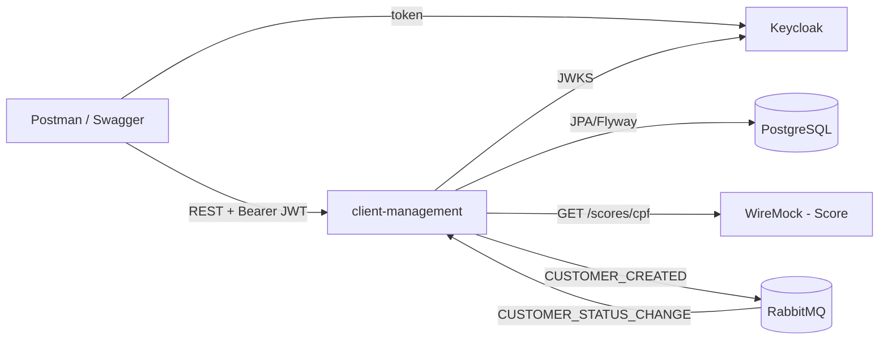

# ClientManagement

Microsserviço de gerenciamento de clientes: CRUD REST, consulta de score externo, segurança OAuth2/JWT (Keycloak) e eventos via RabbitMQ.

> **Status:** em desenvolvimento. Este README descreve o comportamento planejado. Itens marcados **TBD** serão confirmados na implementação (ver as issues no GitHub).

## Funcionalidades
- Cadastro, alteração, exclusão e consulta de clientes (`/customers`).
- Listagem paginada com filtro por status e busca por nome (sem distinção de maiúsculas/acentos).
- Consulta de score (`GET /customers/{id}/score`) em serviço externo, com timeout, retry e circuit breaker.
- Autenticação/autorização OAuth 2.0 + JWT (Resource Server). Perfis `USER` (leitura) e `ADMIN` (leitura e escrita).
- Publicação de `CUSTOMER_CREATED` no RabbitMQ (após commit, com fallback em outbox).
- Consumo idempotente de `CUSTOMER_STATUS_CHANGE`, com retry e DLQ.
- Erros padronizados (RFC 7807), Swagger UI, collection Postman e health check (Actuator).

## Arquitetura da solução

- **Stack:** Java 21, Spring Boot 4.1.2, Maven, Spring Web, Spring Data JPA, Spring Security (Resource Server), Spring AMQP, Flyway, PostgreSQL 16, Resilience4j, springdoc-openapi, JUnit 5, Testcontainers, WireMock, Docker.
- Detalhes e decisões: [`docs/ARCHITECTURE.md`](docs/ARCHITECTURE.md). Escopo e requisitos não funcionais: [`docs/PRODUCT.md`](docs/PRODUCT.md).

## Requisitos para execução
- Docker e Docker Compose v2.
- Para rodar fora de container ou executar os testes: JDK 21. O Maven não é necessário, porque o projeto usa o wrapper `mvnw`.
- Portas livres: 8080 (app), 8081 (Keycloak), 5432 (Postgres), 5672/15672 (RabbitMQ), 8089 (WireMock).

## Como iniciar as dependências
```bash
docker compose up -d postgres rabbitmq keycloak wiremock
```
- O Keycloak importa automaticamente o realm `client-management` (`docker/keycloak/`).
- O WireMock carrega os stubs de `docker/wiremock/mappings/`.
- O RabbitMQ Management fica em http://localhost:15672 (`guest/guest`).

## Como iniciar a aplicação
Tudo em containers:
```bash
docker compose up --build
```
Ou a aplicação localmente, com as dependências já no ar:
```bash
./mvnw spring-boot:run        # Windows: mvnw.cmd spring-boot:run
```
Health: http://localhost:8080/actuator/health · Swagger UI: http://localhost:8080/swagger-ui.html

## Como obter e usar o Access Token
Usuários de teste do realm `client-management`:

| Usuário | Senha | Perfis |
|---------|-------|--------|
| `user`  | `user`  | USER |
| `admin` | `admin` | USER, ADMIN |

```bash
curl -s -X POST http://localhost:8081/realms/client-management/protocol/openid-connect/token \
  -d grant_type=password -d client_id=client-management-cli \
  -d username=admin -d password=admin
```
- Use o `access_token` retornado no header `Authorization: Bearer <token>`.
- O `client_id` é `client-management-cli` (cliente público com direct access grants).
- A collection Postman em `postman/` já obtém o token automaticamente.

## Como executar os testes
```bash
./mvnw test      # testes unitários, funcionais e não funcionais (requer Docker em execução para Testcontainers)
./mvnw verify    # + relatório de cobertura JaCoCo em target/site/jacoco/index.html
```
- Unitários: junto ao pacote testado.
- Funcionais: `src/test/java/com/datum/clientmanagement/functional/`.
- Não funcionais: `src/test/java/com/datum/clientmanagement/nonfunctional/`.

## Endpoints disponíveis
| Método | Caminho | Perfil | Sucesso | Erros |
|--------|---------|--------|---------|-------|
| POST | `/customers` | ADMIN | 201 | 400, 401, 403, 409 (CPF duplicado) |
| PUT | `/customers/{id}` | ADMIN | 200 | 400 (inclui `version` ausente), 404, 409 (`version` divergente), 422 (troca de CPF) |
| DELETE | `/customers/{id}` | ADMIN | 204 (também para id inexistente ou já excluído: idempotente) | — |
| GET | `/customers/{id}` | USER/ADMIN | 200 | 404 |
| GET | `/customers?status=ACTIVE&name=&page=0&size=20` | USER/ADMIN | 200 | 400 |
| GET | `/customers/search?name=joao&page=0&size=20` | USER/ADMIN | 200 | 400 |
| GET | `/customers/{id}/score` | USER/ADMIN | 200 | 404, 502, 503, 504 |
| GET | `/actuator/health` | público | 200 | 503 (banco ou RabbitMQ fora do ar) |

- Os erros seguem a RFC 7807 (`application/problem+json`).
- Cliente inexistente: 404 com o título padrão `Not Found` e detalhe `No customer exists with id <id>.` (exceto DELETE, que é idempotente e retorna 204).
- **Paginação:** os padrões são `page=0` e `size=20`. `page < 0`, `size < 1` ou `size > 100` resultam em 400, com `errors[]` indicando o campo (ex.: "size must be between 1 and 100").
- **Concorrência:** toda resposta de cliente traz `version`. O `PUT` exige o `version` lido por último. Se o `version` divergir, a resposta é 409. Se estiver ausente, 400.
- **Score:** o serviço externo indisponível (conexão recusada, timeout de conexão, 5xx após retries, circuit breaker aberto) gera 503. Uma resposta lenta (timeout de leitura) gera 504. Score inexistente gera 404, e uma resposta inválida gera 502.
- **Health:** `/actuator/health` mostra `db`, `rabbit` e `circuitBreakers`. O Score é opcional: com o circuit breaker aberto, `circuitBreakers.details.score.status` fica `CIRCUIT_OPEN`, mas o status geral continua `UP` (200). Banco ou RabbitMQ fora do ar deixam o status geral `DOWN` (503).

## Configurações necessárias
Os valores padrão ficam em `application.yaml` e podem ser sobrescritos por variáveis de ambiente (lista completa em `.env.example`):

| Variável | Descrição | Padrão (dev) |
|----------|-----------|--------------|
| `DB_URL` / `DB_USERNAME` / `DB_PASSWORD` | PostgreSQL | `jdbc:postgresql://localhost:5432/clientmanagement` / `clientmanagement` / `clientmanagement` |
| `RABBITMQ_HOST` / `RABBITMQ_PORT` / `RABBITMQ_USERNAME` / `RABBITMQ_PASSWORD` | RabbitMQ | `localhost` / `5672` / `guest` / `guest` |
| `ISSUER_URI` | Issuer do Keycloak | `http://localhost:8081/realms/client-management` |
| `JWK_SET_URI` | Chaves de assinatura do Keycloak (no compose: `http://keycloak:8080/...`) | `http://localhost:8081/realms/client-management/protocol/openid-connect/certs` |
| `SCORE_BASE_URL` | Serviço de Score | `http://localhost:8089` |
| `SCORE_CONNECT_TIMEOUT` / `SCORE_READ_TIMEOUT` | Timeouts | `1s` / `2s` |
| `RABBITMQ_CONFIRM_TIMEOUT` | Tempo máximo de espera pela confirmação do RabbitMQ antes de gravar o evento na outbox | `5s` |
| `OUTBOX_RELAY_INTERVAL` | Intervalo do reenvio de eventos | `5s` |
| `OUTBOX_BATCH_SIZE` | Máximo de eventos reenviados por execução | `100` |
| `OUTBOX_RETRY_WAIT_DURATION` / `OUTBOX_RETRY_BACKOFF_MULTIPLIER` / `OUTBOX_RETRY_MAX_WAIT_DURATION` | Espera após uma falha de reenvio (Resilience4j retry `outbox`: multiplicada a cada falha, até o máximo) | `1s` / `2` / `15s` |
| `OUTBOX_RETRY_MAX_ATTEMPTS` | Falhas de reenvio até o evento desistir e virar "linha morta" (≈ 24 h no máximo de 15 s) | `5760` |
| `RABBIT_LISTENER_RETRY_MAX_RETRIES` | Retries de uma falha transitória em qualquer listener RabbitMQ, hoje só o de `CUSTOMER_STATUS_CHANGE` (total de tentativas = 1 + este valor) antes da DLQ | `2` |
| `RABBIT_LISTENER_RETRY_INITIAL_INTERVAL` / `RABBIT_LISTENER_RETRY_MULTIPLIER` / `RABBIT_LISTENER_RETRY_MAX_INTERVAL` | Backoff exponencial entre essas tentativas | `1s` / `2` / `10s` |

## Exemplos de utilização das APIs
```bash
TOKEN=<access_token do admin>

# Criar
curl -X POST http://localhost:8080/customers -H "Authorization: Bearer $TOKEN" \
  -H "Content-Type: application/json" \
  -d '{"name":"João da Silva","cpf":"529.982.247-25","email":"joao@email.com"}'
# → 201 {"id":1,"name":"João da Silva","cpf":"52998224725","email":"joao@email.com",
#        "status":"ACTIVE","version":0,"createdAt":"...","updatedAt":"..."}

# Alterar (version obrigatório, igual ao último lido)
curl -X PUT http://localhost:8080/customers/1 -H "Authorization: Bearer $TOKEN" \
  -H "Content-Type: application/json" \
  -d '{"name":"João da Silva","email":"joao.silva@email.com","status":"ACTIVE","version":0}'
# → 200 {..., "version":1}. Reenviar com "version":0 → 409

# Buscar por nome e filtrar por status
curl -H "Authorization: Bearer $TOKEN" "http://localhost:8080/customers/search?name=joao"
curl -H "Authorization: Bearer $TOKEN" "http://localhost:8080/customers?status=ACTIVE"

# Score
curl -H "Authorization: Bearer $TOKEN" http://localhost:8080/customers/1/score
# → {"customerId":1,"cpf":"52998224725","score":750,"classification":"LOW_RISK"}
```
O WireMock do compose (`docker/wiremock/mappings/`) responde ao `GET /scores/{cpf}` conforme o CPF do cliente:

| CPF | Resposta do Score | Resposta de `GET /customers/{id}/score` |
|-----|-------------------|------------------------------------------|
| `52998224725` | 200 `{"score":750,"classification":"LOW_RISK"}` | 200 |
| `11144477735` | 404 | 404 (`title` "Score not found") |
| `39053344705` | 500 | 503 (após 2 tentativas) |
| `93541134780` | 200 com atraso de 3 s (acima do timeout de leitura de 2 s) | 504 |

Qualquer outro CPF não tem stub, e o WireMock responde 404.

## Funcionamento da integração com RabbitMQ
- **Exchange** `customer.events` (topic).
- **CUSTOMER_CREATED**
  - O evento é publicado com routing key `customer.created` (fila `customer.created`) logo após o commit do cadastro, com publisher confirms.
  - Se o RabbitMQ estiver indisponível, recusar (nack), não confirmar a tempo ou devolver a mensagem como não roteável, o evento é gravado na tabela `outbox_events`. O cadastro continua respondendo 201.
  - Um job agendado (a cada `OUTBOX_RELAY_INTERVAL`) reenvia os eventos pendentes, do mais antigo para o mais novo, com o mesmo `eventId`, até ter sucesso. Cada falha incrementa `attempts`, grava `last_error`, `last_error_type` (`BROKER_DOWN`, `CONFIRM_TIMEOUT`, `NACK` ou `UNROUTABLE`) e `last_failed_at`, e adia `next_attempt_at` (backoff exponencial até `OUTBOX_RETRY_MAX_WAIT_DURATION`). Cada evento é reenviado na sua própria transação curta, e várias instâncias podem rodar o job ao mesmo tempo (`SKIP LOCKED`).
  - Quando `attempts` chega a `OUTBOX_RETRY_MAX_ATTEMPTS` (padrão 5760, cerca de 24 h), a aplicação registra um log ERROR com o `eventId` e para de reenviar o evento: ele vira uma "linha morta" em `outbox_events`. Aumentar `OUTBOX_RETRY_MAX_ATTEMPTS` depois faz as linhas mortas voltarem a ser reenviadas sozinhas. Para listar e reenviar manualmente:
    ```sql
    -- Linhas mortas (use o valor configurado de OUTBOX_RETRY_MAX_ATTEMPTS)
    SELECT event_id, aggregate_id, attempts, last_error_type, last_error, last_failed_at
    FROM outbox_events
    WHERE sent_at IS NULL AND attempts >= 5760
    ORDER BY created_at;

    -- Reenviar uma linha morta (o job a publica na próxima execução)
    UPDATE outbox_events SET attempts = 0, next_attempt_at = now() WHERE event_id = '<event_id>';
    ```
  - A entrega é *at-least-once*: consumidores devem deduplicar por `eventId`. Uma confirmação que expira depois de o broker aceitar a mensagem gera uma duplicata no reenvio.
  - Limitação aceita: se a aplicação cair entre o commit do cadastro e a gravação na outbox, o evento é perdido.
  ```json
  {"eventId":"7ba85b17-...","eventType":"CUSTOMER_CREATED","customerId":123,"createdAt":"2026-08-11T15:30:00Z"}
  ```
- **CUSTOMER_STATUS_CHANGE**
  - Publique na exchange `customer.events` com routing key `customer.status.change` (fila `customer.status-change`).
  - Idempotência: o `eventId` é registrado em `processed_events` na mesma transação da alteração. Uma mensagem repetida é ignorada.
  - Uma mensagem inválida ou com cliente inexistente vai direto para a DLQ `customer.status-change.dlq`.
  - Uma falha transitória tem 3 tentativas no total (entrega inicial + 2 retries com backoff) e depois vai para a DLQ.
  ```json
  {"eventId":"cbca5352-...","eventType":"CUSTOMER_STATUS_CHANGE","customerId":123,"status":"INACTIVE"}
  ```
- Para testar: RabbitMQ Management → Exchanges → `customer.events` → *Publish message*.

## Estrutura do projeto
```
src/main/java/com/datum/clientmanagement/   customer, messaging, security, common/error, config
src/main/resources/db/migration/            migrações Flyway
src/test/java/com/datum/clientmanagement/   unitários, functional/, nonfunctional/
docker/                                     realm Keycloak, stubs WireMock
postman/                                    collection Postman
docs/                                       PRODUCT, ARCHITECTURE
```

## Deploy
Apenas execução local via Docker Compose. Não há ambientes de staging/produção.

## Fluxo de contribuição
1. Ticket como issue no GitHub (label `ticket`), com critérios de aceite.
2. Testes escritos primeiro (pendentes com `@Disabled("pending: implementer")`).
3. Implementação até os testes passarem (`./mvnw verify`).
4. Revisão e commit local. A entrega será feita posteriormente em um repositório Git acessível aos avaliadores.
