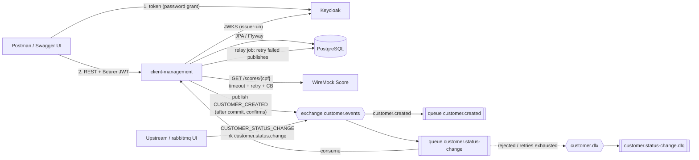

# Architecture — ClientManagement

Status: **planned**. The repo is still the Spring Initializr skeleton. Items marked TBD get decided during implementation.

## Components
| Component | Tech | Role |
|-----------|------|------|
| `client-management` (app) | Spring Boot 4.1.2, Java 21, Maven | REST API, JPA, Resource Server, AMQP publisher and consumer, Score client |
| PostgreSQL 16 | container | customers, outbox, processed events |
| RabbitMQ (management image) | container | `CUSTOMER_CREATED` out, `CUSTOMER_STATUS_CHANGE` in, DLQ |
| Keycloak | container, realm imported at startup | Issues JWTs (realm `client-management`) |
| WireMock | container plus `mappings/` | Simulates the external Score API `GET /scores/{cpf}` |

## Package layout (`com.datum.clientmanagement`)
- `customer`: entity, repository, service, controller, DTOs, CPF validator/normalizer.
- `score`: `ScoreClient` (RestClient + Resilience4j), DTOs, score endpoint.
- `messaging`: AMQP topology config, `CustomerCreated` publisher, outbox entity and relay, status-change listener, `processed_events`.
- `security`: `SecurityFilterChain` and the Keycloak role → `ROLE_*` converter.
- `common.error`: `@RestControllerAdvice` (validation `errors[]`, generic 500). Business errors are thrown as `ResponseStatusException`.
- `config`: typed `@ConfigurationProperties` (Score, messaging, outbox, pagination).

## Data model
Source of truth: `src/main/resources/db/migration` (Flyway). Hibernate runs with `ddl-auto=validate`.

- **customers**: `id` bigserial PK, `name` varchar(150) not null, `name_normalized` varchar(150) not null (lowercased, accents stripped; indexed), `cpf` char(11) **unique** not null, `email` varchar(254) not null, `status` varchar(20) not null (`ACTIVE|INACTIVE`), `created_at`, `updated_at` timestamptz, `version` bigint (optimistic lock).
- **outbox_events**: `id` bigserial PK, `event_id` uuid unique, `event_type`, `aggregate_id` (customer id), `payload` jsonb, `created_at`, `attempts` int, `last_error` text, `next_attempt_at`, `sent_at` (null = pending).
- **processed_events**: `event_id` uuid PK, `event_type`, `processed_at`.

Relations: none enforced between the event tables and `customers`. They are logs keyed by id or uuid.

## REST API (all under `/customers`, JSON)
| Method | Path | Role | Success | Notable errors |
|--------|------|------|---------|----------------|
| POST | `/customers` | ADMIN | 201 + `Location` | 400 validation, 409 duplicate CPF |
| PUT | `/customers/{id}` | ADMIN | 200 | 400 (incl. missing `version`), 404, 409 `version` mismatch, 422 CPF change |
| DELETE | `/customers/{id}` | ADMIN | 204 (also for an unknown or already-deleted id: idempotent) | — |
| GET | `/customers/{id}` | USER, ADMIN | 200 | 404 |
| GET | `/customers?status=&name=&page=&size=&sort=` | USER, ADMIN | 200 page | 400 invalid status |
| GET | `/customers/search?name=` (paged) | USER, ADMIN | 200 page | 400 blank name |
| GET | `/customers/{id}/score` | USER, ADMIN | 200 `{customerId,cpf,score,classification}` | 404 customer, 404 score, 502, 503, 504 |

Customer response: `{id,name,cpf,email,status,version,createdAt,updatedAt}`. PUT body: `{name,email,status,version (required),cpf?}`.

Pagination: defaults `page=0`, `size=20`, configurable through `app.pagination.default-page` / `default-size` (env `PAGINATION_DEFAULT_PAGE` / `PAGINATION_DEFAULT_SIZE`). `page<0`, `size<1` or `size>100` returns 400 with `errors[]`. No clamping.

All customer-not-found cases return 404 (standard title `Not Found`, detail `No customer exists with id <id>.`), except DELETE, which is idempotent and returns 204.

Page response shape: `{ "content": [...], "page": { "size", "number", "totalElements", "totalPages" } }` (Spring Data `PagedModel` via DTO serialization).

## Auth
- Spring Security OAuth2 Resource Server. JWTs are validated against `spring.security.oauth2.resourceserver.jwt.issuer-uri`, which points at the Keycloak realm.
- Keycloak realm `client-management` is imported from a JSON file under `docker/keycloak/`. It contains realm roles `USER` and `ADMIN`, users `user/user` (USER) and `admin/admin` (USER + ADMIN), and a public client with direct-access grants. The client id is `client-management-cli` (file `docker/keycloak/client-management-realm.json`).
- A custom `JwtAuthenticationConverter` maps `realm_access.roles` to `ROLE_<role>`.
- Issuer mismatch between the host (`localhost`) and the compose network (`keycloak`): Keycloak runs with `KC_HOSTNAME=http://localhost:8081` (plus `KC_HOSTNAME_BACKCHANNEL_DYNAMIC=true`), so every token carries `iss=http://localhost:8081/realms/client-management`, whether it was requested from the host or from inside compose. The app validates that issuer (`ISSUER_URI`) but fetches signing keys through `JWK_SET_URI`, which inside compose is `http://keycloak:8080/realms/client-management/protocol/openid-connect/certs`. Spring Boot uses the JWK set URI for keys and still checks the `iss` claim against `issuer-uri`, so no OIDC discovery call to `localhost` is made from inside the container.
- 401 and 403 responses are ProblemDetail, produced by a custom entry point and access-denied handler.

## External integration: Score
- Spring `RestClient`, base URL `SCORE_BASE_URL`. Connect timeout 1 s, read timeout 2 s.
- Resilience4j `retry` (max 2 attempts, exponential backoff, only on 5xx/IO/timeout) wrapped in a `circuitbreaker` (50% failure rate, window 10, open 10 s).
- Error mapping (PRODUCT NFR-5): connection refused, connect timeout, 5xx after retries or circuit open → 503. Read timeout only → 504. Score 404 → 404 `Score not found`. Malformed body or other 4xx → 502.
- WireMock mappings, keyed by CPF, cover OK, 404, 500 and delay > read timeout. The specific CPFs are decided during the ticket 05 implementation and documented in the README.

## Messaging (RabbitMQ)
- Topic exchange `customer.events`.
  - Routing key `customer.created`. Queue `customer.created` is declared so events can be inspected.
  - Routing key `customer.status.change` → queue `customer.status-change`, with DLX `customer.dlx` → `customer.status-change.dlq`.
- JSON with the Jackson message converter. Publisher confirms are on (`correlated`), plus mandatory returns.
- **CUSTOMER_CREATED (hybrid after-commit + outbox fallback, user decision)**
  1. The service saves the customer and raises a Spring application event.
  2. `@TransactionalEventListener(AFTER_COMMIT)` publishes and waits for the confirm (timeout configurable, ~5 s).
  3. On nack, timeout, return or exception, the event is stored in `outbox_events` (new transaction).
  4. A `@Scheduled` relay (every 5 s) resends pending rows, ordered by `created_at`, sets `sent_at` on confirm, and increments `attempts` and `last_error` on failure, with backoff via `next_attempt_at`. It retries until it succeeds.
  - Payload: `{eventId, eventType:"CUSTOMER_CREATED", customerId, createdAt}`. Delivery is at-least-once, so consumers must dedupe by `eventId`.
- **CUSTOMER_STATUS_CHANGE consumer**
  - Payload: `{eventId, eventType, customerId, status}`.
  - One transaction: insert into `processed_events` → if the PK already exists, ack and skip (duplicate) → else update the customer status.
  - Malformed JSON, missing fields, unknown `eventType`, invalid status or unknown customer: reject without requeue → DLQ immediately.
  - Transient errors (e.g. DB down): stateless retry with `maxAttempts=3` (first delivery + 2 retries, exponential backoff), then `RejectAndDontRequeueRecoverer` → DLQ.

## Errors
`@RestControllerAdvice` returns `ProblemDetail` (`application/problem+json`) with `title`, `status`, `detail`, `instance`. Validation errors add `errors: [{field, message}]`.

## Configuration
`application.yaml` holds defaults, and env vars override them (DB URL/user/password, RabbitMQ host/port/credentials, `ISSUER_URI`, `SCORE_BASE_URL`, timeouts, retry, outbox interval). There is a `test` profile for Testcontainers. The full list goes in README "Configurações".

## Environments and deployment
- **local**: `docker compose up --build` (multi-stage `Dockerfile`; app + 4 dependencies with healthchecks). Alternative: run dependencies with compose and the app with `./mvnw spring-boot:run`.
- **test**: Testcontainers (Postgres, RabbitMQ) and WireMock (in-JVM). Keycloak is not needed in tests (mock JWTs via `spring-security-test`).
- staging/prod: none (out of scope).

## Key decisions (ADR-lite)
- **ADR-1 PostgreSQL 16**: realistic relational DB with `jsonb` for the outbox. H2 is not used, to avoid dialect drift.
- **ADR-2 Flyway + `ddl-auto=validate`**: versioned, reviewable schema. Hibernate never mutates it.
- **ADR-3 Keycloak**: real OAuth2 issuer with an importable realm, so evaluators get tokens from Postman without extra code.
- **ADR-4 RestClient + Resilience4j**: synchronous code fits Spring MVC. Timeouts, retry and circuit breaker cover the "slow" and "unavailable" scenarios.
- **ADR-5 Hybrid publish (after commit, outbox only on failure)**: the user's decision. It gives low latency in the happy path and survives RabbitMQ outages. Trade-off: if the app crashes between commit and the outbox write, the event is lost. This is accepted and documented. Duplicates are possible (confirm timeout after the broker accepted), so delivery is at-least-once.
- **ADR-6 `processed_events` table for idempotency**: dedupe lives in the same transaction as the state change, so it is exact across restarts.
- **ADR-7 `name_normalized` column**: accent- and case-insensitive search that is portable and indexable, without needing the `unaccent` extension.
- **ADR-8 RFC 7807 ProblemDetail**: standard error format, native to Spring 6+.
- **ADR-9 Hard delete**: simplest semantics. Status already models inactivity.
- **ADR-10 Java 21**: allowed by the PDF ("17 or higher") and the LTS that Boot 4 targets. Requires changing `java.version` in `pom.xml` from 17 to 21 (ticket 01).
- **ADR-11 Client-supplied `version` on PUT**: the client must send the `version` it last read. A mismatch returns 409, so lost updates are detected across requests, not only within concurrent transactions.
